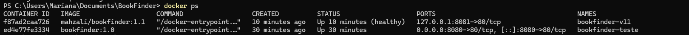

# BookFinder — Explorador de Livros

**Autora:** Mariana Oliveira Mazali  
**RA:** 22552647

## Descrição

O BookFinder é uma aplicação web desenvolvida para facilitar a busca e consulta de informações sobre livros.

O projeto utiliza a API pública Open Library para realizar pesquisas e apresentar informações relevantes sobre os livros encontrados de forma organizada e amigável para o usuário.

## Objetivo

Criar uma aplicação frontend capaz de consumir uma API pública, processar seus dados e apresentar as informações de forma organizada e amigável para o usuário.

## Funcionalidades

- Pesquisa de livros por título ou autor;
- Pesquisa utilizando o botão "Buscar";
- Pesquisa pressionando a tecla Enter;
- Exibição do título do livro;
- Exibição do autor;
- Exibição do ano da primeira publicação;
- Exibição da quantidade de edições;
- Exibição da capa do livro quando disponível;
- Mensagem quando nenhum livro é encontrado;
- Mensagem para pesquisa vazia;
- Tratamento de erros de conexão ou da API;
- Exibição dos resultados de forma organizada.

## Tecnologias utilizadas

- HTML5
- CSS3
- JavaScript
- Fetch API
- Open Library API

## API utilizada

O projeto utiliza a **Open Library API** para realizar as pesquisas de livros.

A aplicação consulta a API de forma assíncrona utilizando `fetch`, processa os dados retornados em formato JSON e apresenta até 10 resultados por pesquisa.

Entre as informações exibidas estão o título, autor, ano da primeira publicação, quantidade de edições e capa do livro, quando disponível.

## Instruções para execução local

1. Clone o repositório:

   `git clone https://github.com/Mah-zali/BookFinder.git`

2. Abra a pasta do projeto.

3. Abra o arquivo `index.html` em um navegador.

4. Digite o nome de um livro ou autor no campo de pesquisa.

5. Clique no botão **Buscar** ou pressione a tecla **Enter**.

6. Os livros encontrados serão apresentados na tela.

## Estrutura do projeto

BookFinder/
│
├── index.html
├── style.css
├── script.js
├── ramo-bookfinder.png
└── README.md

### Documentação

https://openlibrary.org/developers/api

### Endpoint utilizado

```text
https://openlibrary.org/search.json

## Links

- **Repositório no GitHub:** https://github.com/Mah-zali/BookFinder
- **Aplicação publicada no GitHub Pages:** https://mah-zali.github.io/BookFinder/

---

## Etapa 02 — Persistência de dados

Nesta etapa, o BookFinder recebeu integração com um banco de dados PostgreSQL hospedado no Supabase.

A aplicação permite adicionar livros aos favoritos, consultar os livros salvos e removê-los. Os registros permanecem armazenados no banco mesmo após fechar o navegador.

### Estrutura do banco

A tabela `favoritos` possui os seguintes campos:

| Campo | Finalidade |
|---|---|
| `id` | Identificador do registro |
| `created_at` | Data e hora do cadastro |
| `titulo` | Título do livro |
| `autor` | Nome do autor |
| `ano_publicacao` | Ano da primeira publicação |
| `capa_id` | Identificador da capa na Open Library |
| `openlibrary_key` | Identificador do livro na Open Library |

As operações são realizadas pela biblioteca JavaScript do Supabase, utilizando `INSERT`, `SELECT` e `DELETE`.

A estrutura SQL e as políticas de acesso estão documentadas no arquivo `database.sql`.

### Limitações conhecidas

A aplicação não possui autenticação de usuários. Para atender aos requisitos acadêmicos, foram configuradas políticas RLS para o papel `anon`, permitindo leitura, inclusão e exclusão dos favoritos.

Consequentemente, a lista de favoritos é compartilhada entre os visitantes, e qualquer pessoa com acesso à aplicação pode adicionar ou excluir registros.

O Supabase utiliza um plano gratuito que pode pausar projetos após períodos de inatividade. Caso isso aconteça, as funcionalidades de favoritos ficarão temporariamente indisponíveis até a reativação do banco. A pesquisa pela Open Library continuará independente do Supabase.

## Etapa 02 — Docker

O BookFinder foi conteinerizado utilizando Docker e Nginx, permitindo executar a aplicação em um ambiente padronizado.

### Docker Hub

https://hub.docker.com/r/mahzali/bookfinder

### Executar a aplicação

Com o Docker instalado e funcionando, execute:

```bash
docker run -d -p 8080:80 mahzali/bookfinder:1.1
```

Depois acesse:

http://localhost:8080

### Versões da imagem

- `1.0` — primeira imagem funcional.
- `1.1` — imagem com healthcheck para verificar se o Nginx responde.
- `latest` — imagem correspondente à versão 1.1.

## Sidequests obrigatórias

### SQ1 — .dockerignore

Foi criado um arquivo `.dockerignore` para excluir arquivos desnecessários do contexto de construção, como o histórico Git, arquivos temporários, configurações locais e documentação.

Isso reduz a quantidade de dados enviados ao processo de build e pode acelerar a construção. O Dockerfile copia apenas os arquivos necessários para servir a aplicação.

### SQ2 — Versionamento das imagens

Foram publicadas três tags no Docker Hub: `1.0`, `1.1` e `latest`.

A versão 1.1 acrescenta uma verificação automática de saúde do servidor Nginx.

### SQ3 — Descrição do Docker Hub

O repositório público do Docker Hub possui uma descrição da aplicação, instruções de execução e link para o código-fonte no GitHub.

### SQ4 — Execução simultânea e orquestração

Foram executados dois containers do BookFinder simultaneamente:

- `bookfinder-teste` — porta 8080, imagem 1.0.
- `bookfinder-v11` — porta 8081, imagem 1.1.

O teste foi realizado com `docker ps`, verificando os dois containers em execução. A versão 1.1 também apresentou status `healthy`.

**Evidência:**



### Como gerenciar 100 containers?

Se fosse necessário administrar 100 containers, a execução manual com comandos Docker se tornaria pouco prática. Uma solução seria utilizar o Kubernetes, uma plataforma de orquestração de containers.

O Kubernetes organiza os recursos em um *cluster*, formado por máquinas que executam as aplicações. Os containers normalmente são executados dentro de unidades chamadas *pods*. Por meio de controladores como o Deployment, é possível manter várias *réplicas* da aplicação, distribuir a carga de trabalho, substituir pods que apresentem falhas e realizar atualizações de maneira controlada.

Assim, em vez de iniciar e acompanhar manualmente 100 containers, o Kubernetes ajudaria a automatizar a implantação, a disponibilidade e o gerenciamento da aplicação.

## Links da entrega

- **Repositório GitHub:** https://github.com/Mah-zali/BookFinder
- **Aplicação no GitHub Pages:** https://mah-zali.github.io/BookFinder/
- **Repositório Docker Hub:** https://hub.docker.com/r/mahzali/bookfinder